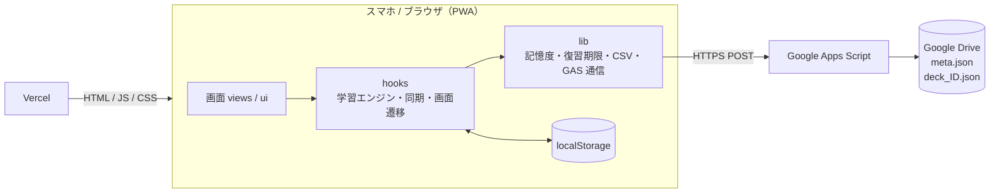

# Rapid Cycle

英単語を**短時間で何周も回して覚える**ための、スマホ向けフラッシュカードアプリです。
TOEIC などの単語学習用に作りました。分からなかった単語が 1 つでも残っている間は、学習が終わりません。

**デモ:** https://rapid-cycle-v2.vercel.app
（初回は「サンプルで試す」から、すぐに学習を始められます。iPhone はホーム画面に追加すると、アプリとして使えます）

---

## 特徴

### 1. 分からない単語だけを、何周も回す
1 周目は全単語を出し、2 周目以降は次の単語で周回します。

- 前の周で「わからない」にした単語：**すべて**
- 前の周で「わかる」にした単語：**一部だけ**（確率で再登場。初期値は 1→2 周目が 33%、それ以降が 50%）

「わからない」が 0 語になり、次の周に出す単語が 2 語以下になったら完了です。
すでに覚えている単語ほど、再登場しにくくなります。

### 2. 「答えを見てから正解」を区別して記憶度を出す
単語ごとに 0〜100% の**記憶度**を計算し、「未学習／要復習／あと少し／定着」の 4 段階で色分けします。
ただの正解率ではありません。

- 2 周目以降の正解は「直前に見たから当たった」可能性が高いので、軽く扱う
- 時間を空けて正解したものほど、重く扱う
- 答えを見てから「わかる」にした場合は、割り引く

### 3. 忘れかけた頃に「今日の復習」
答えを見ずに正解できた回が続くほど、次の復習までの間隔を **1 → 3 → 7 → 14 → 30 → 60 日**と延ばします（間違えたら 10 分後）。
復習期限が来た単語は全単語帳から集め、期限を過ぎた時間が長い順に並べます。

### 4. 気持ちよく続けられる操作
- カードを**右に払うと「わかる」、左に払うと「わからない」**
- 1 回目に払うと、カードが払った方向に回転して答えが見える。もう一度払うかタップすると確定する。逆方向に払えば判定を変えられる
- 判定した瞬間に次のカードへ進むので、アニメーションを待つ必要がない
- 間違えて判定したら「もどす」で 1 手戻せる

### 5. データは自分の手元と Google Drive に
データはブラウザの中（localStorage）に保存するので、オフラインでも学習できます。
Google Apps Script を設定すると、自分の Google Drive に単語帳ごとの JSON ファイルとしてバックアップできます。

---

## 使い方

1. **単語帳を作る**：右下の「＋」→「単語帳を追加」で、CSV ファイルを選ぶか、テキストを貼り付けます
2. **学習する**：単語帳の ▶ を押す。または詳細画面で、出題数（10/25/50）と記憶度で絞って開始します
3. **カードを払う**：右なら「わかる」、左なら「わからない」。タップすると答えを先に見られます
4. **復習する**：ホームに「今日の復習」が出たら、期限が来た単語をまとめて学習できます

ほかにできること：
- **横断学習**：全単語帳、またはフォルダ内の単語をまとめて出題
- **フォルダ分け**、**並べ替え**（＋ →「並び替え」でドラッグ）
- 単語の追加・編集・検索、CSV の書き出し（クリップボードにコピー）
- テーマ切り替え（ダーク／ライト／クール）、再登場率と復習間隔の調整

### CSV の形式

```csv
word,meaning,example_en,example_ja,note
comply,従う、準拠する,All branches must comply with the new regulations.,全支店が新しい規制に従わなければならない。,comply with ～ の形で使う
```

- 列は「英単語, 意味, 例文（英）, 例文（和訳）, 補足」の順です。2 列（英単語と意味）や 4 列でも読み込めます
- タブ区切りにも対応しています。1 行目のヘッダーはあってもなくても構いません
- カードは ChatGPT や Claude などの AI に作らせて、CSV で取り込む使い方を想定しています

---

## 技術構成

| 分類 | 使っているもの |
|---|---|
| UI | React 19、framer-motion 12（画面遷移・フォルダ開閉・並べ替え）、CSS 変数によるテーマ |
| ビルド | Vite 8 |
| 保存 | localStorage（端末内が正本） |
| クラウド同期 | Google Apps Script ＋ Google Drive（[`gas/Code.gs`](gas/Code.gs)） |
| オフライン | Service Worker（network-first）＋ Web App Manifest による PWA |
| ホスティング | Vercel（GitHub に push すると自動デプロイ） |
| テスト・静的解析 | Vitest（47 件）、ESLint（react-hooks） |

外部の状態管理ライブラリやバックエンドサーバーは使っていません。

### 全体の構成



### ディレクトリ構成

```
src/
├── lib/            # 純粋なロジック（React に依存しない・テスト対象）
│   ├── memory.js       # 記憶度スコア・レベル・再登場率の倍率
│   ├── review.js       # 復習期限（間隔反復）
│   ├── csv.js          # CSV の読み書き
│   ├── gasClient.js    # GAS との通信
│   ├── storage.js      # localStorage の読み書き
│   └── utils.js        # シャッフル・ID 生成など
├── state/          # アプリ全体の状態
│   ├── useAppState.js  # 単語帳・学習記録・フォルダ・設定（localStorage と自動同期）
│   ├── useAppActions.js# 操作（ローカル更新とクラウド同期の通知を必ずセットで行う）
│   ├── migrations.js   # 古いデータ形式の移行
│   └── AppContext.jsx
├── hooks/
│   ├── useStudyEngine.js # 周回のルール・記録・もどす
│   ├── useCardSwipe.js   # スワイプ判定（Pointer Events。マウスでも操作可）
│   ├── useCloudSync.js   # クラウド同期（まとめて送る・失敗時の再送・復元）
│   ├── useNavigation.js  # 画面遷移（スタック方式）・左端スワイプで戻る
│   └── useLatest.js
├── components/
│   ├── ui/         # Modal / Toast / FilterChips / MemoryBar / CardFace / WordList / Icons
│   └── views/      # Home / Folder / DeckDetail / StudySetup / Import / Study / Result / Settings
└── styles/
    ├── tokens.css  # デザイントークン（テーマごとの色・角丸など）
    └── app.css
gas/Code.gs         # Google Drive 同期用のサーバー側スクリプト
public/             # Service Worker・manifest・アイコン
```

---

## 設計で工夫したところ

- **待ち時間ゼロのカード操作**
  判定したらすぐ次のカードに切り替え、飛んでいくカードは別のレイヤーでアニメーションさせています。
  連続で払ったときの誤判定は、2 つのガードで防いでいます。確定直後の 120ms は入力を受け付けないこと、そして触り始めと離したときのカードが同じかを確かめることです。
- **記憶度と復習期限を、学習記録から毎回計算**
  復習期限などは保存せず、単語ごとの学習記録（直近 100 件）から毎回計算します。データの形を変えずに機能を追加できます。
- **スペルを直しても記録が消えない**
  単語ごとに ID を持たせ、学習記録は ID で引いています。
- **クラウド同期は差分だけ・失敗しても失わない**
  - 送るのは変更があった単語帳だけです。編集は 3 秒待ってまとめて送り、学習後は触れた単語帳だけを送ります
  - 送信に失敗した操作は、端末内のキューに残して後で再送します
  - 復元は、全部を取得し終えてから一度に置き換えます。途中で通信が切れても、データが中途半端になりません
- **ロジックを画面から分離してテスト**
  壊れると静かにデータが壊れる部分（CSV の往復、通信データの形、記憶度、復習間隔）を、Vitest で固定しています。
- **iPhone での使いやすさ**
  - iOS のアプリ内ブラウザでは `confirm()` が動かないので、確認はすべて自作のモーダルで行います
  - ファイルのダウンロードも動かないので、書き出しはクリップボードへのコピーにしています
  - 切り欠きを避けたレイアウトにし、テーマの色をステータスバーにも合わせています

---

## 開発環境で動かす

```bash
npm install
npm run dev      # 開発サーバー（http://localhost:5173）
npm test         # テスト（Vitest）
npm run lint     # ESLint
npm run build    # 本番ビルド（dist/）
```

### Vercel にデプロイする

`vercel.json` を同梱しています。GitHub のリポジトリを Vercel に Import すると、そのままデプロイできます（Framework: Vite、Build: `npm run build`、Output: `dist`）。

`vercel.json` では次を設定しています。

- すべてのパスを `/` に振り分ける（SPA）
- `sw.js` はキャッシュさせない（新しい版をすぐ反映するため）
- ファイル名にハッシュの付いた `/assets/*` は、1 年キャッシュする

---

## Google Drive 同期の設定（任意）

設定しなくても、端末の中だけで使えます。

1. Google Drive にバックアップ用のフォルダを作り、URL の `folders/` の後ろにある**フォルダ ID** を控える
2. [script.google.com](https://script.google.com/) で新しいプロジェクトを作り、[`gas/Code.gs`](gas/Code.gs) の内容を貼り付ける
3. 先頭の `FOLDER_ID` を、手順 1 の ID に書き換える
4. 「デプロイ」→「新しいデプロイ」→ 種類：**ウェブアプリ**、実行するユーザー：**自分**、アクセスできるユーザー：**全員** でデプロイする
5. 表示された **ウェブアプリの URL** を、アプリの「設定 → クラウドバックアップ (GAS)」に貼り付ける

設定すると、次のように動きます。

- 単語帳の作成・編集・削除や学習の終了に合わせて、自動で送信する
- 起動時に端末のデータが空なら、自動で復元する
- 「今すぐバックアップ」と「復元する」を手動で実行できる

Drive のフォルダには `meta.json`（フォルダ情報）と `deck_<ID>.json`（単語帳ごとの単語と学習記録）が作られます。

> **注意**：ウェブアプリの URL を知っている人は、誰でもデータを読み書きできます。URL は人に教えないでください。アプリの「全データをコピー」で作るバックアップには、URL は含まれません。
> `Code.gs` を変更したときは、「デプロイを管理」→ 編集 → バージョン「新しいバージョン」で再デプロイしてください（URL は変わりません）。

---

## 制限と今後の課題

- 同期は「最後に保存した方が勝つ」方式です。複数の端末で同時に編集すると、後から送った内容で上書きされます
- GAS 側に認証がありません（URL が合言葉の代わりです）
- テストはロジックの単体テストだけで、画面操作のテストはまだありません

---

## 開発の経緯

最初の版（v1）は、1 ファイル約 5,000 行で機能を足しながら作りました。開発の試行錯誤は、v1 のリポジトリ [918taiki/rapid-cycle](https://github.com/918taiki/rapid-cycle) のコミット履歴に残っています。たとえば、画面遷移の演出の作り直し、スワイプの二重判定の修正、クラウド保存方式の変更（スプレッドシートの 1 セル → 単語帳ごとのファイル）です。

このリポジトリ（v2）は、v1 の学習ロジックとデータの互換性を保ったまま、責務ごとにファイルを分けて設計し直した版です。主な変更点は次の通りです。

- 1 ファイルの構成を、`lib / state / hooks / components` に分割した
- 互換性が壊れやすい箇所に、47 件の自動テストを追加した
- テーマを CSS 変数に移し、クールテーマを追加した
- Pointer Events への対応、単語検索、トースト通知、戻る操作の履歴管理などを追加した

v1 とはデータ形式が同じです（localStorage のキー、CSV、Drive のファイル形式、全データ JSON）。そのため、v1 のデータをそのまま読み込めます。
